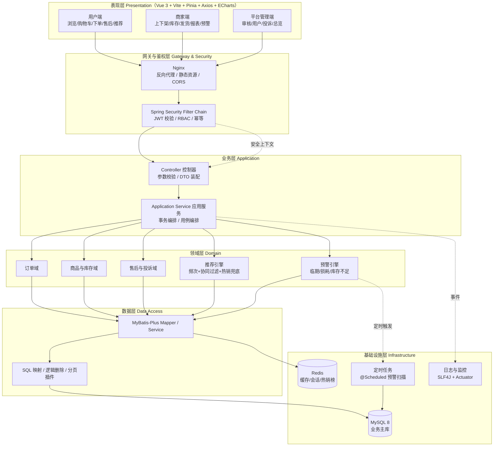

# 系统架构设计

> 文档名称：水果交易智能管理系统 —— 系统架构设计
> 所属阶段：P2 系统设计与数据建模
> 撰写成员：架构设计智能体
> 对应版本：v1.0

---

## 1. 架构设计目标与约束

### 1.1 设计目标

| 目标 | 说明 |
|------|------|
| 三端统一 | 用户端、商家端、平台管理端共享同一套后端服务与统一 API 入口，通过角色与数据权限隔离 |
| 分层清晰 | 表现层、网关与鉴权层、业务层、领域层、数据层、基础设施层职责单一、依赖单向 |
| 可扩展 | 推荐引擎、预警引擎以独立领域服务形式存在，算法可替换而不影响业务代码 |
| 安全 | 全链路 JWT 鉴权、RBAC 角色控制、敏感数据加密、接口幂等与参数校验 |
| 可教学 | 技术栈主流、结构直观，便于软件工程课程演示与二次开发 |

### 1.2 关键约束

- 技术栈已定：后端 Spring Boot 3.x + Java 17 + MyBatis-Plus + MySQL 8 + Spring Security/JWT；前端 Vue 3 + Vite + Pinia + Axios + ECharts。
- 课程项目范围：支付采用模拟支付（不接入真实第三方支付网关）；消息通知以站内记录为主。
- 数据规模为教学级，暂不引入分库分表与分布式事务，但预留缓存与异步任务扩展点。

---

## 2. 总体架构风格

系统采用**分层架构（Layered Architecture） + 前后端分离**风格，后端内部进一步融合**领域驱动设计（DDD）的轻量分层思想**。整体为六层结构，横切关注点（推荐、预警、日志、安全）以独立组件横向贯穿。

### 2.1 架构图（Mermaid）

对应的 PlantUML 源文件：`docs/uml/系统架构图.puml`

### 2.2 分层职责说明

| 层次 | 主要职责 | 关键组件 | 允许依赖 |
|------|----------|----------|----------|
| 表现层 | 三端页面渲染、交互、状态管理、调用 API、图表展示 | Vue 3 组件、Pinia Store、Axios 封装、ECharts | 仅依赖网关层 API |
| 网关与鉴权层 | 统一入口、路由转发、CORS、JWT 解析、角色放行、限流与幂等 | Nginx、Spring Security Filter Chain | 业务层 |
| 业务层 | 接收请求、DTO 校验、用例编排、事务边界、返回统一响应 | Controller、Application Service | 领域层、数据层 |
| 领域层 | 核心业务规则、领域对象、推荐与预警算法 | Domain Model、Domain Service、引擎 | 数据层（通过接口） |
| 数据层 | ORM 映射、CRUD、分页、逻辑删除、SQL 优化 | MyBatis-Plus Mapper、XML | 数据库、缓存 |
| 基础设施层 | 数据库连接、缓存、定时任务、日志监控、文件存储 | MySQL、Redis、@Scheduled、Actuator | 无（被依赖） |

> 依赖原则：上层可依赖下层，下层不得反向依赖上层；领域层不直接依赖具体框架实现，通过接口访问数据，保证可测试性与算法可替换性。

---

## 3. 核心组件职责

| 组件 | 职责 | 对应包/模块 |
|------|------|-------------|
| AuthComponent | 登录注册、JWT 签发与刷新、当前用户上下文 | `com.fruittrade.auth` |
| UserController / MerController / AdminController | 三端 REST 接口入口，按角色分流 | `com.fruittrade.controller` |
| OrderApplicationService | 下单、支付、取消、发货、订单状态流转编排 | `com.fruittrade.service` |
| ProductService / InventoryService | 商品上下架、库存扣减与流水、安全库存校验 | `com.fruittrade.service` |
| AfterSaleService / ComplaintService | 售后申请处理、投诉受理与处理 | `com.fruittrade.service` |
| RecommendationEngine | 基于用户历史的个性化推荐，输出 TopN 商品 | `com.fruittrade.engine.recommend` |
| WarningEngine | 临期、损耗、库存不足扫描与预警等级计算 | `com.fruittrade.engine.warning` |
| ReportService | 销售报表聚合、平台数据总览统计 | `com.fruittrade.service` |
| AuditService | 商家资质审核、审核记录留痕 | `com.fruittrade.service` |
| GlobalExceptionHandler | 统一异常处理，映射错误码 | `com.fruittrade.common.exception` |
| JwtAuthenticationFilter | 解析 Token、注入 SecurityContext | `com.fruittrade.security` |

---

## 4. 三端统一入口与数据隔离

三端共用网关 `/api` 前缀，通过角色码与归属字段实现逻辑隔离：

- **USER**：仅可访问本人购物车、订单、售后、地址、推荐数据。
- **MERCHANT**：仅可访问本商家（`merchant_id`）名下商品、库存、订单、售后与报表。
- **ADMIN**：可访问全部资源，负责审核、用户管理、投诉处理与总览统计。

实现方式：JWT 中携带 `userId`、`role`、`merchantId`（商家角色非空）；在数据层通过 MyBatis-Plus 自动填充与查询条件注入（如 `merchant_id = 当前商家`）实现行级数据权限，避免越权访问。

---

## 5. 跨域与安全策略

### 5.1 跨域（CORS）

- 开发环境：后端配置 `CorsConfiguration`，允许 `localhost:5173`（Vite）等来源，允许 `GET/POST/PUT/DELETE/OPTIONS`，允许 `Authorization`、`Content-Type` 头，暴露响应头。
- 生产环境：由 Nginx 统一处理跨域与反向代理，前端与后端同域部署，从根本上规避跨域。

### 5.2 安全策略

| 维度 | 策略 |
|------|------|
| 认证 | 登录成功签发 JWT（含角色与归属信息），后续请求 Header `Authorization: Bearer <token>` |
| 授权 | Spring Security 基于注解 `@PreAuthorize` 与路径规则进行 RBAC 校验 |
| 密码 | BCrypt 加盐哈希存储，禁止明文 |
| 传输 | 生产环境启用 HTTPS |
| Token 安全 | 合理过期时间、刷新机制、登出黑名单（可选 Redis） |
| 接口防护 | 参数校验（Validation）、幂等键（下单/支付）、重复提交限制、敏感操作二次确认 |
| 业务安全 | 服务端强校验库存与状态机，禁止前端传值决定价格与库存 |
| 审计 | 关键操作（审核、发货、售后处理、支付）写入审计/流水表 |

---

## 6. 推荐引擎与预警引擎在架构中的位置

两引擎均位于**领域层**，由应用服务在合适时机调用，通过 Mapper 读取数据、通过 Redis 缓存结果：

- **推荐引擎**：用户端请求推荐或浏览商品详情时调用。读取订单明细历史，计算购买频次权重、User-Based 协同过滤相似度，并以近 30 天热销榜兜底，混合排序后返回 TopN 商品 ID，再装配商品详情返回。缓存键按 `user:{id}:recommend` 设置短期过期，历史订单变更时失效。
- **预警引擎**：由 `@Scheduled` 定时任务周期性触发（如每日凌晨），也可在商家端查询时实时计算。扫描在售商品，结合生产日期、保质期天数、安全库存与近 7 日销量，计算临期天数与损耗风险，产出预警等级并写入预警记录；商家端通过接口查询与 ECharts 展示。

详细算法规则见 `docs/02-系统设计/详细设计.md`。

---

## 7. 技术选型理由

| 技术 | 选型理由 |
|------|----------|
| Spring Boot 3.x | 生态成熟、自动配置、与 Spring Security 3.x 无缝集成，Java 17 基线 |
| Java 17 | LTS 版本，语法特性modern，课程与生产均适用 |
| MyBatis-Plus | 简化单表 CRUD、内置分页/逻辑删除/条件构造器，适合教学与快速开发 |
| MySQL 8 | 稳定开源、支持事务与 JSON、utf8mb4 完整中文支持 |
| Spring Security + JWT | 无状态认证，天然适配前后端分离与三端多角色 |
| Vue 3 + Vite | 组合式 API、响应式快、构建迅速，适合交互丰富的三端页面 |
| Pinia | 轻量状态管理，替代 Vuex，类型友好 |
| Axios | 拦截器统一处理 Token、统一响应与错误码 |
| ECharts | 销售报表、总览统计、预警趋势可视化成熟方案 |
| Redis（可选增强） | 缓存推荐结果、热销榜、会话与验证码，教学环境可用本地缓存降级 |
| PlantUML / Mermaid | 文档化建模，便于版本管理与评审 |

---

## 8. 关键设计决策与权衡

| 编号 | 决策 | 备选方案 | 权衡与理由 |
|------|------|----------|------------|
| D1 | 单一后端服务 + 模块化分层 | 微服务拆分 | 教学规模下单体更易部署与调试，模块化保留演进空间 |
| D2 | 逻辑删除（deleted 字段） | 物理删除 | 保留数据痕迹、便于审计与恢复，查询需带 deleted=0 |
| D3 | 模拟支付 | 接入真实支付 | 课程无需真实资金流，模拟支付可完整演示状态流转 |
| D4 | JWT 无状态认证 | Session | 前后端分离与多端扩容友好，配合黑名单实现可控登出 |
| D5 | 推荐结果缓存 + 热销兜底 | 每次实时全量计算 | 降低计算开销，冷启动有兜底，用户体验稳定 |
| D6 | 预警定时扫描 + 实时查询 | 纯实时 | 定时写入便于历史趋势与报表，实时查询满足即时性 |
| D7 | 行级数据权限注入 | 端侧自行过滤 | 服务端强隔离，防止越权，前端仅做展示层过滤 |
| D8 | Long 类型雪花/自增主键 | UUID | 自增 BigInt 索引紧凑、查询高效，教学更易理解 |

---

## 9. 质量属性考虑

- **性能**：列表分页、合理索引（见数据库设计）、推荐与热销缓存、报表预聚合。
- **可扩展性**：算法引擎接口化、配置化阈值、模块化包结构支持新增端或新算法。
- **可维护性**：统一响应与错误码、分层清晰、PlantUML 与文档同步。
- **安全性**：JWT + RBAC + 数据权限 + 审计 + 参数校验的多层防护。
- **可测试性**：领域服务与算法可独立单测，Controller 层可 Mock 测试。

---

撰写成员：架构设计智能体
对应版本：v1.0
