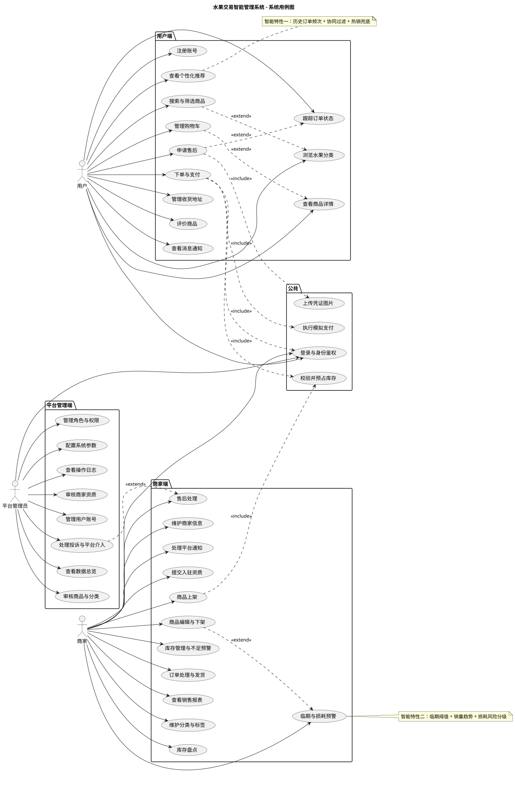
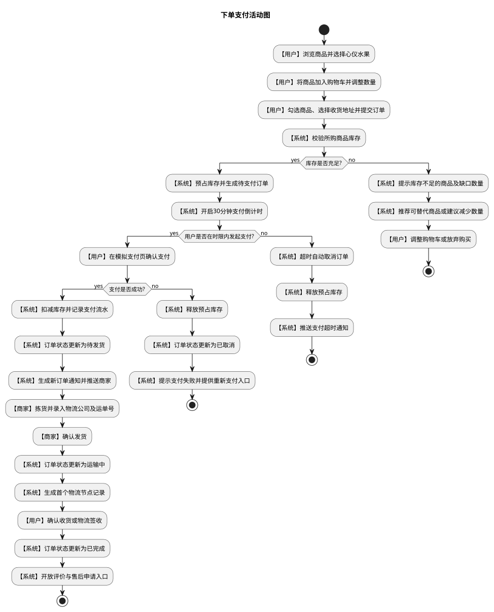
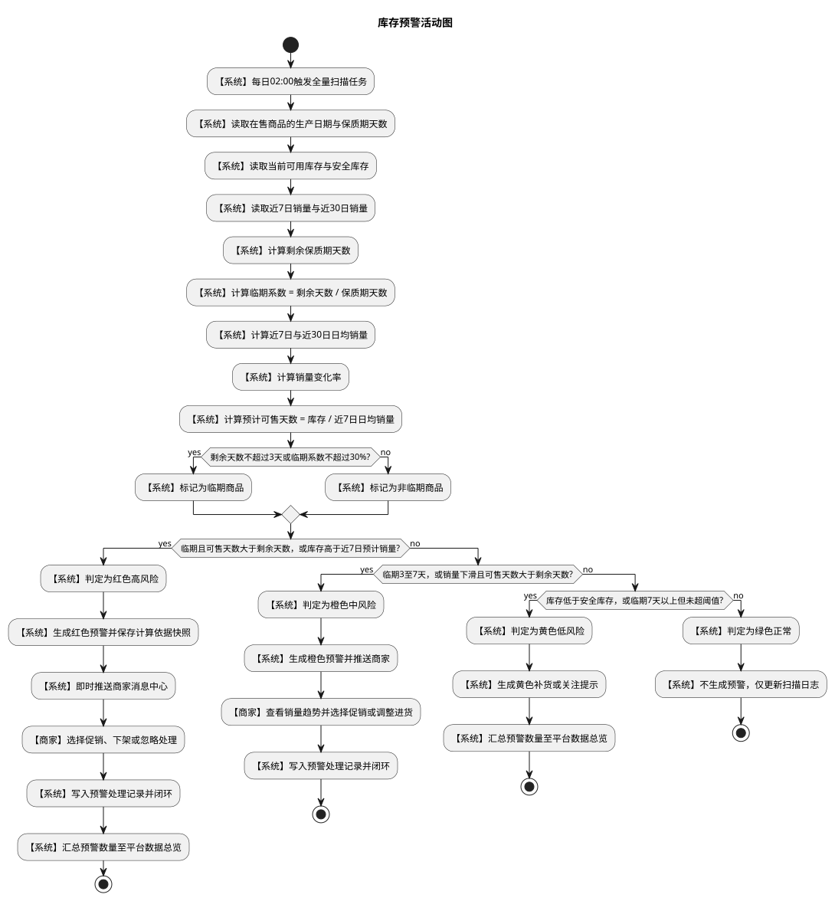
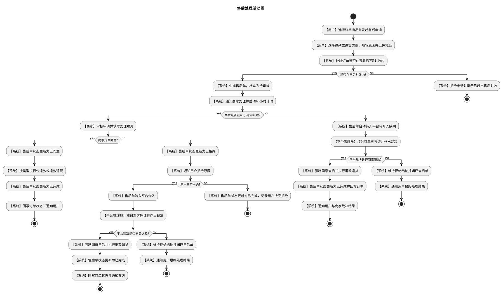
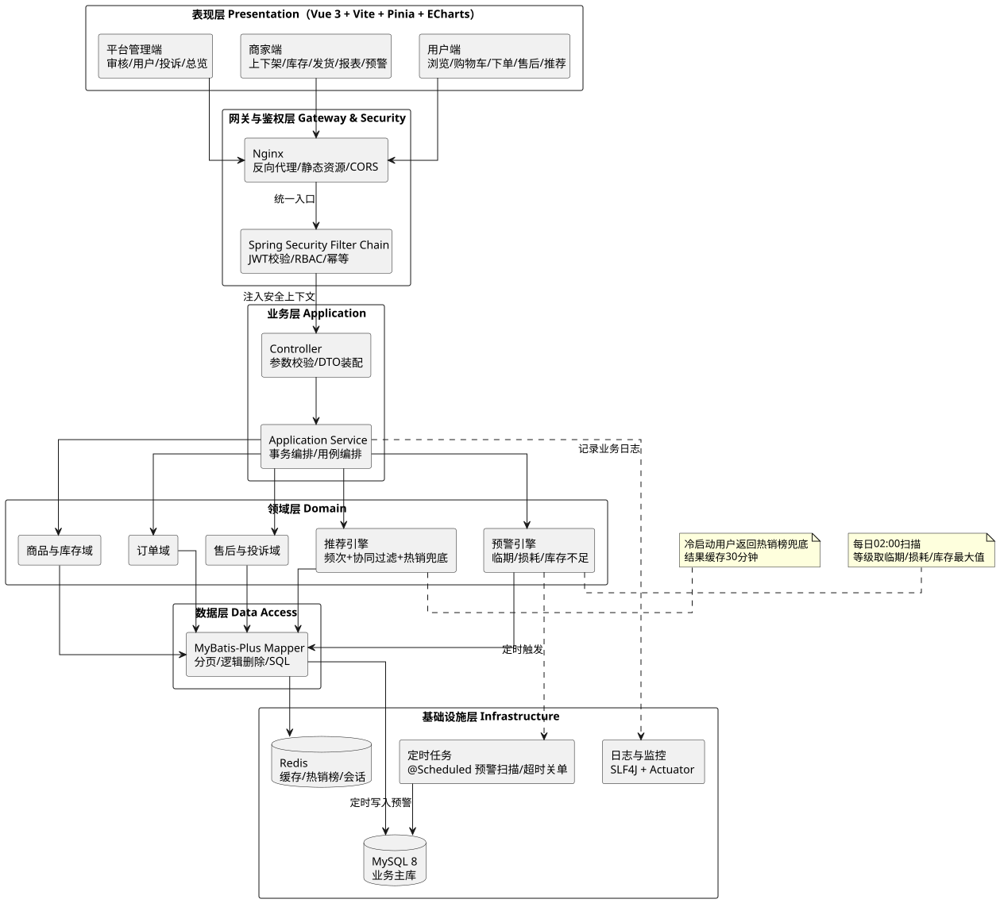
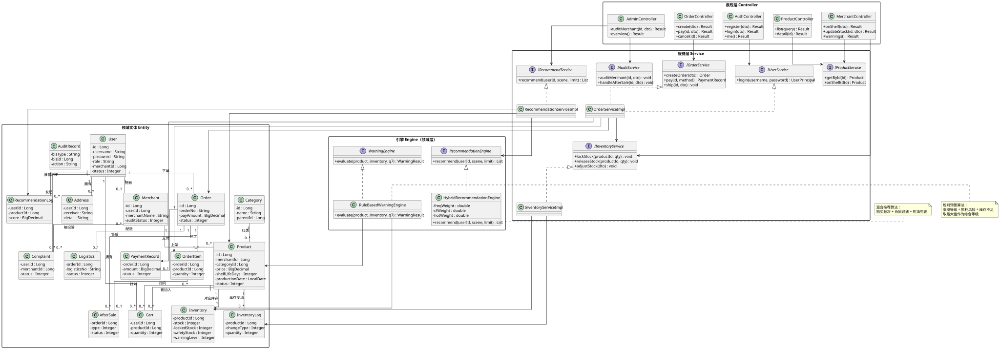
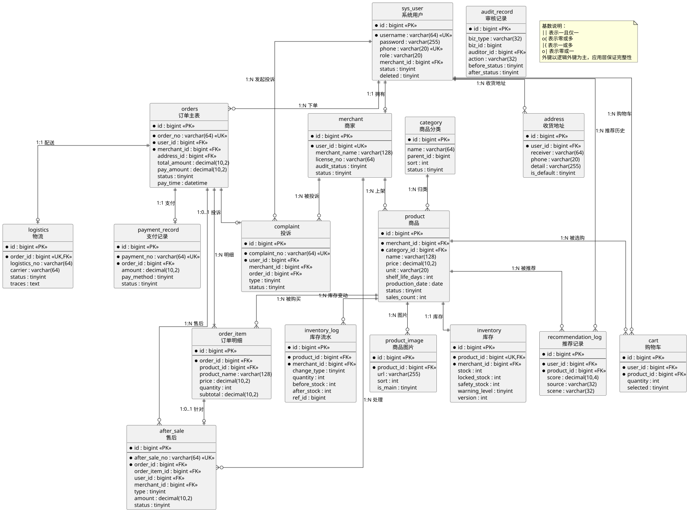
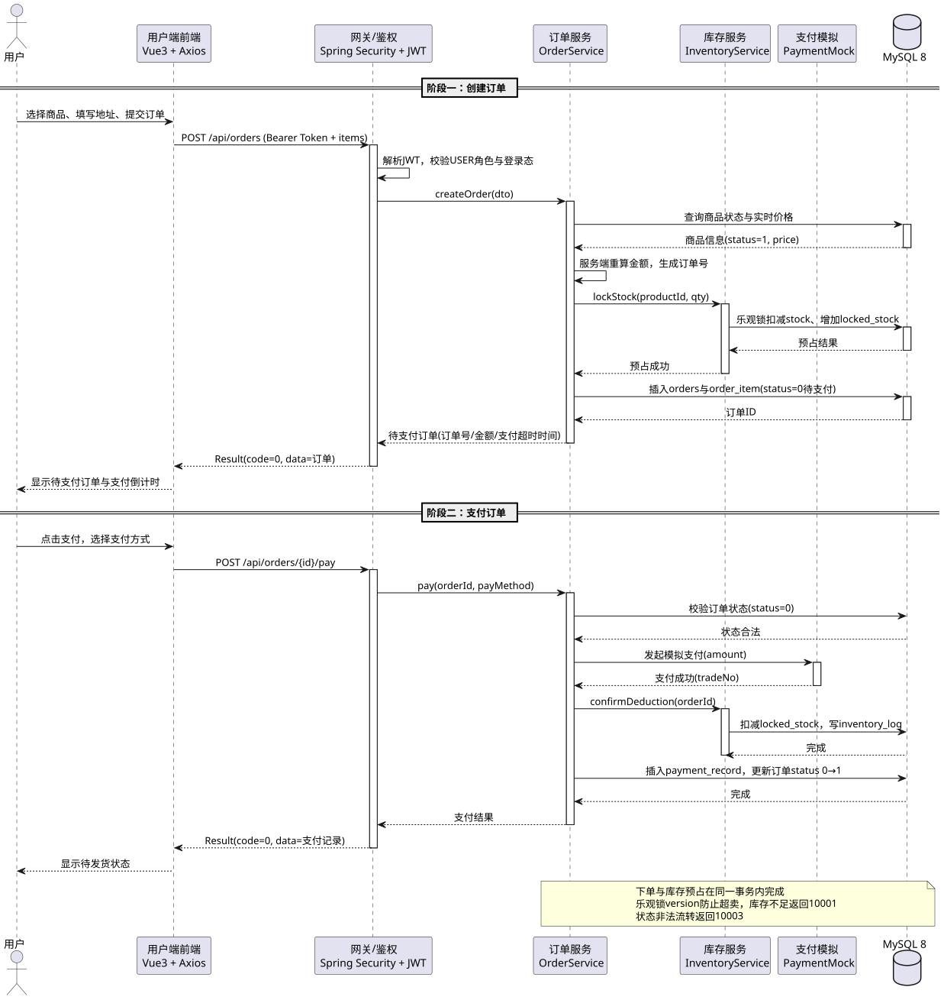
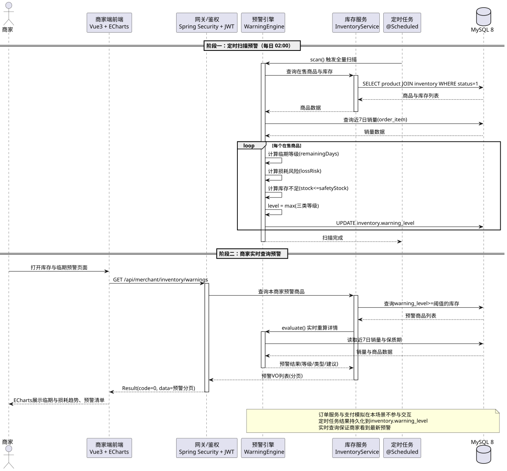
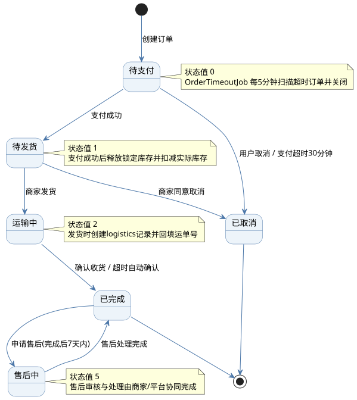

# 水果交易智能管理系统 — 软件工程课程大作业报告

| 项目 | 内容 |
|---|---|
| 项目名称 | 水果交易智能管理系统（fruit-trade-smart-system） |
| 报告版本 | v1.0 |
| 编制成员 | 主管智能体（统筹汇总） |
| 编制日期 | 2026-11-21 |
| 代码基线 | Git 仓库 `fruit-trade-smart-system` / master |
| 文档基线 | 需求 SRS-FTS-v1.0 / 设计 DESIGN-FTS-v1.0 |

---

## 目录

1. 项目计划及达成情况
2. 周报与周会纪要
3. 需求分析（含 UML 核心图表）
4. 系统详细设计（架构设计 / 详细设计 / 数据库设计）
5. 测试报告
6. 软件使用说明书
7. 软件部署说明书
8. 附录：成员分工与产物索引

---

# 第 1 章 项目计划及达成情况

**撰写成员：主管智能体**

## 1.1 项目背景与目标

随着生鲜电商发展，本地果农与水果经销商亟需一套能够打通货源上架、客户下单、库存管理、物流配送与售后服务的完整链路系统。本项目以软件工程课程大作业为目标，交付一套可运行的三端 Web 系统，并以完整的模型与过程文档体现规范化开发流程。

项目目标：
1. 实现用户端、商家端、平台管理端三类角色的一次完整业务闭环；
2. 实现基于历史购买记录的个性化推荐与基于保质期/销量的库存损耗预警；
3. 按 需求 → 设计 → 编码 → 测试 → 部署 流程推进，各阶段均有可追溯产物；
4. 交付 Git 仓库形式的完整代码与全套过程文档。

## 1.2 团队组织

团队由 6 个智能体角色组成，职责与产物如下：

| 角色 | 职责 | 主要产物 |
|---|---|---|
| 主管智能体 | 需求拆解、任务排期、进度跟踪、阶段整合、最终汇总 | 项目计划、周报与周会纪要、阶段确认记录、本报告 |
| 需求分析智能体 | 三端用户故事、用例与业务流程 | 需求规格说明书、用户故事、用例图、活动图 |
| 架构设计智能体 | 架构、模块、类与数据模型、部署方案 | 架构/数据库/详细/部署/API 契约文档、7 张设计 UML |
| 后端开发智能体 | 业务接口、智能规则、数据库脚本 | Spring Boot 工程 132 个 Java 文件、18 个单元测试、init.sql |
| 前端开发智能体 | 三端页面与交互、接口对接 | Vue 3 工程 24 个页面、46 个接口封装 |
| 测试与文档智能体 | 测试用例、测试报告、使用与部署说明书 | 4 份测试与交付文档 |

## 1.3 阶段计划与达成情况

| 阶段 | 计划任务 | 责任人 | 状态 | 达成情况 |
|---|---|---|---|---|
| P0 | 项目计划与团队组建 | 主管 | ✅ 完成 | 项目计划、Git 仓库、任务看板 |
| P1 | 需求分析与功能建模 | 需求分析 | ✅ 完成 | 32 FR、18 NFR、14 智能规则、20 用户故事、4 张功能 UML |
| P2 | 系统设计与数据建模 | 架构设计 | ✅ 完成 | 5 份设计文档、17 张表、46 接口、7 张设计 UML |
| P3 | 阶段评审确认 | 主管 | ✅ 完成 | 质量门通过，放行编码 |
| P4 | 编码实现 | 后端/前端 | ✅ 完成 | 后端编译+18 单测通过；前端 24 页构建通过 |
| P5 | 系统测试 | 测试与文档 | ✅ 完成 | 测试用例与测试报告 |
| P6 | 交付文档 | 测试与文档 | ✅ 完成 | 使用说明书、部署说明书 |
| P7 | 整合与汇总 | 主管 | ✅ 完成 | 本报告与全部交付物索引 |

## 1.4 技术栈决策

后端采用 Spring Boot 3.2.5 + Java 17，持久层 MyBatis-Plus，数据库 MySQL 8.0，安全采用 Spring Security + JWT；前端采用 Vue 3 + Vite 5 + Pinia + Axios + ECharts。选择理由是团队对 Java/Vue 熟悉度高，单体分层架构便于课程演示与本地部署，文本化 UML 保证模型与代码同库可追溯。

## 1.5 约束执行说明

- **先需求确认再编码**：P3 阶段由主管评审 P1/P2 产物并签署《阶段确认记录》后，才放行 P4 编码。
- **文档与代码版本对应**：全部产物在同一 Git 仓库中管理，各文档标注 v1.0 与撰写成员；API 契约为前后端唯一依据。
- **术语一致性**：P1 与 P2 在售后状态、预警等级上存在表述差异，通过 SRS 第 6.4 节双向映射表闭环，代码以 P2 枚举码落库、界面以 P1 中文文案展示。

---

# 第 2 章 周报与周会纪要

**撰写成员：主管智能体**

> 完整记录见 `00-项目管理/周报与周会纪要.md`，本章摘录核心内容。

## 2.1 第 1 周工作

目标：立项与团队组建、完成 P1/P2 建模、通过 P3 质量门。

| 阶段 | 负责人 | 状态 | 关键产出 |
|---|---|---|---|
| P0 | 主管 | 完成 | 项目计划、仓库、看板 |
| P1 | 需求分析 | 完成 | SRS、用户故事、4 张功能 UML |
| P2 | 架构设计 | 完成 | 5 份设计文档、17 表、46 接口、7 张设计 UML |
| P3 | 主管 | 完成 | 阶段确认记录 |

关键数据：11 个 PlantUML 源文件全部编译通过并导出 SVG；需求追踪矩阵覆盖 FR ↔ 36 用例 ↔ 活动图。

风险与处理：
- P1/P2 术语口径差异 → SRS 6.4 节建立双向映射，已闭环；
- 本地缺少 Maven 与 PlantUML → 在 `.tools/` 准备便携工具，不污染系统环境；
- 前后端接口对齐风险 → 以 API 契约为唯一依据，并安排独立集成核对。

## 2.2 阶段评审周会纪要（2026-11-21）

主持人：主管智能体；参会：需求分析智能体、架构设计智能体。

决议：
1. 需求基线 SRS v1.0 通过；
2. 设计基线 DESIGN-FTS-v1.0 通过；
3. 术语冲突以 SRS 6.4 映射表解决，不再修改设计文档；
4. 11 张 UML 图源文件与 SVG 一并交付；
5. P3 质量门通过，后端与前端并行进入 P4。

## 2.3 第 2 周工作（编码与交付）

后端完成 46 个接口、17 张表、推荐与预警引擎，Maven 编译与 18 个单元测试通过；前端完成 24 个页面与 46 个接口封装，`npm run build` 通过；测试与文档智能体完成测试用例、测试报告、使用说明书与部署说明书；独立集成核对完成前后端字段与账号一致性校验。

---

# 第 3 章 需求分析（含 UML 核心图表）

**撰写成员：需求分析智能体（本章由主管智能体汇编）**

## 3.1 需求概览

系统包含三类参与者：普通用户、商家、平台管理员。共定义 32 条功能需求（用户端 12 / 商家端 12 / 平台端 8）、18 条非功能需求、14 条智能特性规则，并建立 FR ↔ 用例 ↔ 测试的追踪矩阵。

| 端 | 核心功能需求（摘要） |
|---|---|
| 用户端 | FR-USER-01~12：分类浏览、搜索、商品详情、购物车、地址管理、下单、支付、订单查询与取消、售后申请与申诉、投诉、推荐 |
| 商家端 | FR-MER-01~12：商品上下架、商品编辑、库存调整、库存不足预警、临期预警、订单发货、物流节点、售后审核、销售报表、投诉响应 |
| 平台端 | FR-ADM-01~08：商家资质审核、用户账号管理、投诉处理、平台数据总览、参数配置 |

## 3.2 核心业务状态

- 订单状态：0 待支付 → 1 待发货 → 2 运输中 → 3 已完成；另有 4 已取消、5 售后中。30 分钟未支付自动取消并释放库存。
- 售后状态：0 待审核 / 1 审核通过 / 2 处理中 / 3 已完成 / 4 已驳回；48 小时未处理转平台介入；用户可申诉。
- 商家审核：0 待审 / 1 通过 / 2 驳回。
- 预警等级：0 正常 / 1 注意 / 2 警告 / 3 严重（对应红/橙/黄/绿展示口径，见 SRS 6.4 映射表）。

## 3.3 UML 核心图表

### 3.3.1 用例图



图 3-1 系统用例图（三端参与者与用例关系，含 include/extend）

### 3.3.2 活动图 — 下单支付



图 3-2 下单支付活动图（含库存校验与库存不足分支）

### 3.3.3 活动图 — 库存预警



图 3-3 库存临期与损耗预警活动图

### 3.3.4 活动图 — 售后处理



图 3-4 售后处理活动图（含平台介入分支）

## 3.4 智能特性需求

1. **个性化推荐**：基于用户历史订单商品购买频次加权，融合 User-Based CF 与近 30 天热销兜底；冷启动用户直接展示热销榜，并附推荐理由标签。
2. **临期与损耗预警**：按生产日期与保质期计算剩余天数（阈值 30/7/3 天），结合近期销量下滑幅度与损耗风险系数（0.2/0.4/0.7）分级，综合等级取各项最大值，支持定时扫描与商家端实时计算。

---

# 第 4 章 系统详细设计

**撰写成员：架构设计智能体（本章由主管智能体汇编）**

## 4.1 系统架构设计

系统采用六层架构：表现层（Vue 3 三端页面）→ 网关与鉴权层（Spring Security + JWT）→ 控制器层 → 业务服务层 → 领域与引擎层（推荐引擎、预警引擎、状态机）→ 数据访问层（MyBatis-Plus + MySQL）。



图 4-1 系统架构图

关键设计决策：
1. 三端统一后端入口，角色通过 JWT 中的 role 与 merchantId 隔离数据；
2. 商家接口按 merchant_id 行级隔离，管理员接口仅 ADMIN 可访问；
3. 推荐与预警以独立 Engine 组件存在，便于规则调整与单元测试；
4. 单体分层部署，降低课程环境搭建成本。

## 4.2 类图与ER图



图 4-2 系统核心类图



图 4-3 数据库 E-R 图

## 4.3 时序图与状态图



图 4-4 下单支付时序图



图 4-5 库存预警时序图



图 4-6 订单状态图

## 4.4 数据库设计

数据库 `fruit_trade_db` 共 17 张表：`sys_user`、`merchant`、`category`、`product`、`product_image`、`inventory`、`cart`、`address`、`orders`、`order_item`、`payment_record`、`logistics`、`after_sale`、`complaint`、`audit_record`、`inventory_log`、`recommendation_log`。统一字符集 `utf8mb4`、审计字段 `create_time/update_time/deleted`（逻辑删除）。

关键表说明：

| 表名 | 用途 | 关键字段 |
|---|---|---|
| sys_user | 三端账号 | username(UK)、password(BCrypt)、role、merchant_id |
| merchant | 商家资质 | user_id(UK)、audit_status、license_no |
| product | 商品 | category_id、merchant_id、price、stock、locked_stock、shelf_life_days、production_date、version |
| orders | 订单 | order_no(UK)、user_id、merchant_id、total_amount、status |
| order_item | 订单明细 | order_id、product_id、quantity、price |
| inventory_log | 库存流水 | product_id、change_type、change_quantity、remark |
| after_sale | 售后单 | order_id、type、status、handle_remark |
| complaint | 投诉 | user_id、target_type、status |

索引与并发控制：`username/phone` 唯一索引，订单与商品外键字段建普通索引；`product.version` 乐观锁防止超卖；下单时 `stock--`、`locked_stock++`，支付扣减 locked_stock，取消回补 stock，全程写入 inventory_log。

## 4.5 智能算法详细设计

**推荐引擎 HybridRecommendationEngine**
```
score(p) = 0.5 * freq(p) + 0.3 * cf(p) + 0.2 * hot(p)
```
- `freq(p)`：用户历史购买该商品的归一化频次；
- `cf(p)`：User-Based CF 邻居用户购买相似度加权；
- `hot(p)`：近 30 天销量归一化值；
- 冷启动用户直接按 `hot(p)` 排序；结果写 `recommendation_log`，本地缓存 30 分钟。

**预警引擎 RuleBasedWarningEngine**
- 临期等级：剩余保质期 >30 天=0；≤30 天=1；≤7 天=2；≤3 天=3；
- 损耗风险：销量下滑比例 <0.2=0；0.2~0.4=1；0.4~0.7=2；>0.7=3；
- 综合等级 = max(临期等级, 损耗等级, 库存不足等级)；
- `InventoryWarningJob` 每日 02:00 扫描回写，商家端也可实时计算。

## 4.6 API 契约

共 46 个接口，统一响应 `{code,message,data,timestamp}`（code=0 成功），分页 `pageNum/pageSize → list/total/pageNum/pageSize/pages`，25 个错误码（含 10001 库存不足、10003 状态非法、40102 Token 失效），JWT Header `Authorization: Bearer <token>`。逐接口定义见 `02-系统设计/API接口契约.md`。

---

# 第 5 章 测试报告

**撰写成员：测试与文档智能体（本章由主管智能体汇编）**

> 完整测试用例与报告见 `03-测试/测试用例.md` 与 `03-测试/测试报告.md`。

## 5.1 测试范围与策略

覆盖认证与权限、用户端（商品/购物车/订单/售后/推荐）、商家端（商品/库存/发货/售后/报表）、平台端（审核/用户/投诉/总览）、智能特性与非功能需求。测试方法包括单元测试、接口契约核对、构建验证与人工验收用例设计。

## 5.2 已执行验证结果

| 验证项 | 环境 | 结果 |
|---|---|---|
| 后端编译 | JDK 21 + Maven 3.9.9 | 通过（EXIT 0） |
| 后端单元测试 | 4 个测试类 / 18 个用例 | 全部通过，Failures=0，Errors=0 |
| 前端依赖安装 | Node.js 22 / npm 10 | 成功（65 packages） |
| 前端生产构建 | Vite 5 | 成功（716 modules transformed，EXIT 0） |
| UML 图编译 | PlantUML 1.2024.7 | 11 张图全部编译通过并导出 SVG |
| 前后端集成核对 | API 契约逐条比对 | 46 个接口一致，字段与账号偏差已修复 |

## 5.3 测试用例设计

共设计 **51 条**结构化测试用例，分 6 个模块：认证与权限 7、用户端 19、商家端 10、平台端 7、智能特性专项 4、非功能 4；其中**异常与边界用例 22 条**，覆盖库存不足、重复下单/重复售后、非法状态流转、Token 失效、越权访问、参数缺失、临期边界、冷启动推荐、退款超时申诉等。每条用例含 9 个字段并关联 FR/NFR/INT 编号，可回溯至需求。

## 5.4 结果统计与结论

| 指标 | 结果 |
|---|---|
| 设计用例总数 | 51 |
| 已实际执行并通过 | 5（另 2 条由单测部分覆盖） |
| 设计态未执行 | 44 |
| 失败用例 | 0 |
| 已执行用例通过率 | 100% |
| 端到端执行率 | 0%（受限于本地未连接真实 MySQL） |

测试报告如实区分「已执行验证」与「设计态用例」：后端 4 个测试类（`HybridRecommendationEngineTest`、`OrderStateMachineTest`、`ResultWrapperTest`、`RuleBasedWarningEngineTest`）共 18 个 JUnit 用例全部通过，覆盖状态机、统一响应与 25 个错误码、推荐评分与冷启动兜底、临期/损耗预警阈值；前端 `npm run build` 成功产出 716 个模块；前后端接口契约核对一致，字段偏差与演示账号偏差已修复。

**结论**：系统达到课程大作业「可编译、可构建、核心规则可验证、交付文档完整」的质量基线，具备交付条件。限制说明：本地未连接真实 MySQL 做全链路端到端联调，51 条功能用例中 44 条处于设计态，建议在部署真实数据库后按用例清单完成验收。

---

# 第 6 章 软件使用说明书

**撰写成员：测试与文档智能体（本章由主管智能体汇编）**

> 完整版见 `04-交付文档/软件使用说明书.md`。

## 6.1 运行环境

浏览器：Chrome / Edge 最新版本；后端服务 http://localhost:8080；前端开发服务由 Vite 输出（默认 5173）。

## 6.2 登录

演示账号（以 `sql/init.sql` 种子数据为准，密码 `123456`）：管理员 `admin`；商家 `merchant01`、`merchant02`；用户 `user01`、`user02`、`user03`。登录页提供一键填充。

## 6.3 用户端主要流程

1. 首页浏览分类与「猜你喜欢」，或使用搜索；
2. 进入商品详情查看价格、库存、保质期与临期提示，加入购物车；
3. 购物车勾选商品 → 去结算 → 选择地址 → 提交订单 → 模拟支付；
4. 订单列表按状态筛选，订单详情查看状态时间轴与物流节点；
5. 需要退换时在订单详情申请售后，填写原因并上传凭证，可查看处理进度与申诉。

## 6.4 商家端主要流程

商品管理（上下架/编辑）→ 库存管理（调整库存、查看不足与临期预警）→ 订单管理（发货并填写物流公司/单号）→ 售后审核（审核通过/驳回并填写意见）→ 销售报表（ECharts）。

## 6.5 平台管理端主要流程

商家资质审核（通过/驳回并填写意见）→ 用户账号管理（启用/禁用）→ 投诉处理 → 平台数据总览。

---

# 第 7 章 软件部署说明书

**撰写成员：测试与文档智能体（本章由主管智能体汇编）**

> 完整版见 `04-交付文档/软件部署说明书.md`。

## 7.1 环境要求

JDK 17+、MySQL 8.0、Node.js 18+、Maven 3.9+（项目 `.tools/` 内置便携版作为本地辅助）。

## 7.2 部署步骤

1. 执行 `mysql -u root -p < sql/init.sql` 初始化数据库；
2. 修改 `backend/src/main/resources/application.yml` 的数据库连接与 JWT 密钥；
3. 后端：`cd backend && mvn -DskipTests compile && mvn spring-boot:run`；
4. 前端开发：`cd frontend && npm install && npm run dev`；
5. 前端生产：`npm run build`，将 `dist/` 交给 Nginx 托管并反向代理 `/api` 到后端 8080；
6. 按 README 验证清单检查登录、下单、预警、报表等核心流程。

## 7.3 常见故障排查

端口占用（调整 server.port 或代理 target）、数据库连接失败（检查账号密码与库名）、跨域（检查 CorsConfig）、Token 失效（重新登录）、npm 安装慢（切换镜像源）。详见完整部署说明书。

---

# 第 8 章 附录：成员分工与产物索引

**撰写成员：主管智能体**

| 成员 | 分工 | 产物路径 |
|---|---|---|
| 主管智能体 | 统筹、计划、质量门、汇总 | `docs/00-项目管理/`、`docs/大作业报告.md`、`README.md` |
| 需求分析智能体 | 需求工程与功能建模 | `docs/01-需求分析/`、`docs/uml/{用例图,活动图*}` |
| 架构设计智能体 | 架构与数据建模 | `docs/02-系统设计/`、`docs/uml/{类图,ER图,时序图*,状态图,系统架构图,部署图}` |
| 后端开发智能体 | 服务端实现 | `backend/`、`sql/init.sql` |
| 前端开发智能体 | 三端界面实现 | `frontend/` |
| 测试与文档智能体 | 测试与交付文档 | `docs/03-测试/`、`docs/04-交付文档/` |

**版本追溯说明**：所有文档均为 v1.0，与 Git 仓库 master 分支代码对应；API 契约为前后端唯一对接依据；阶段确认记录签署前不得进入编码阶段，本流程已严格执行。
